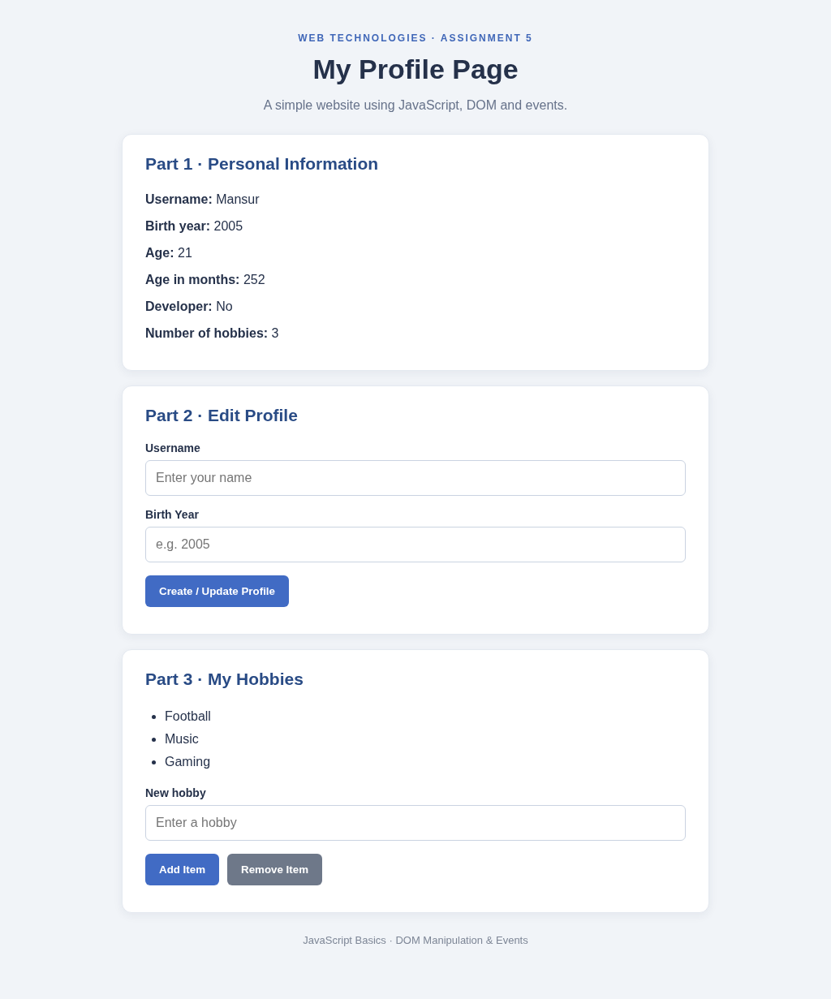
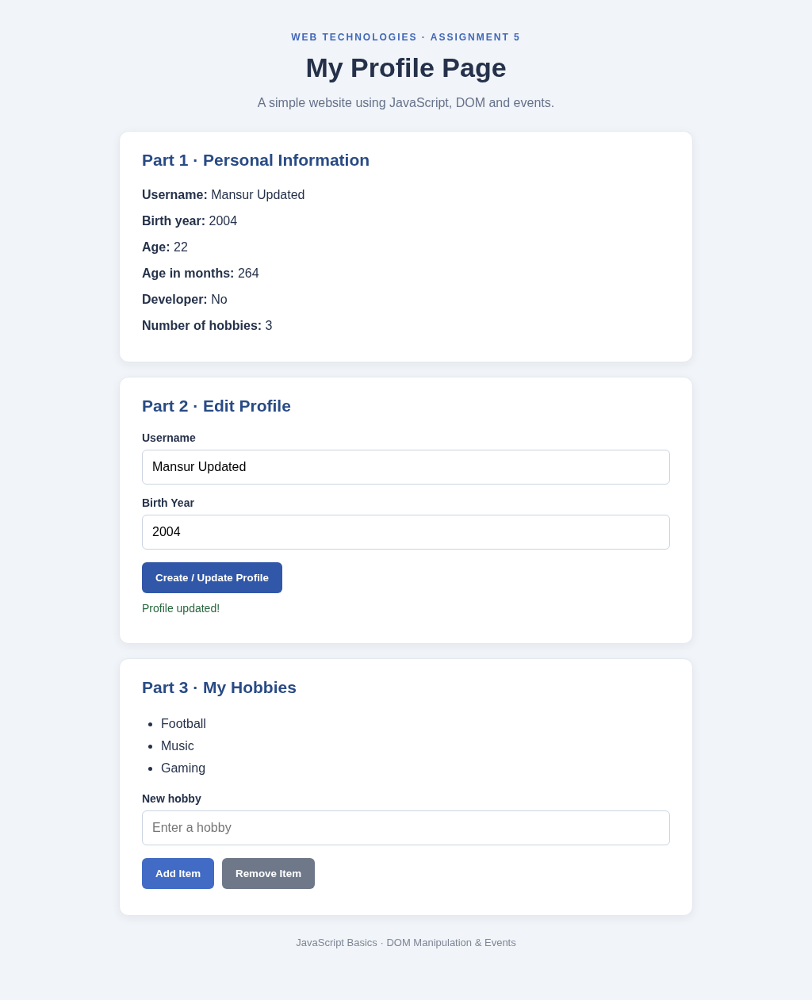
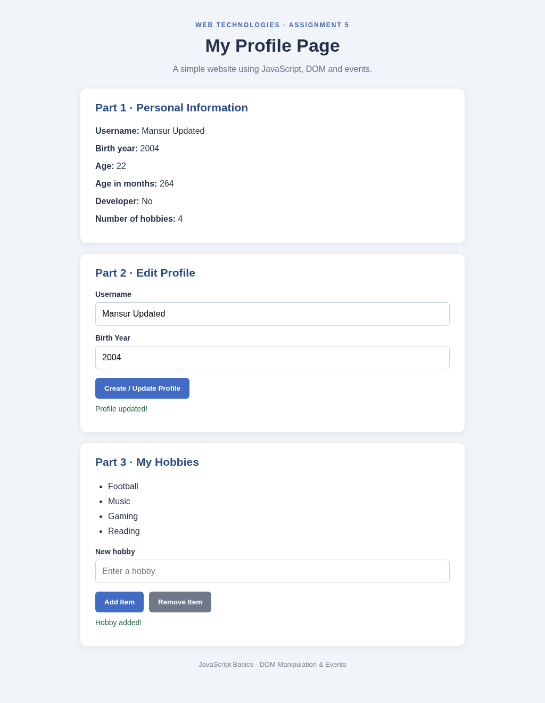
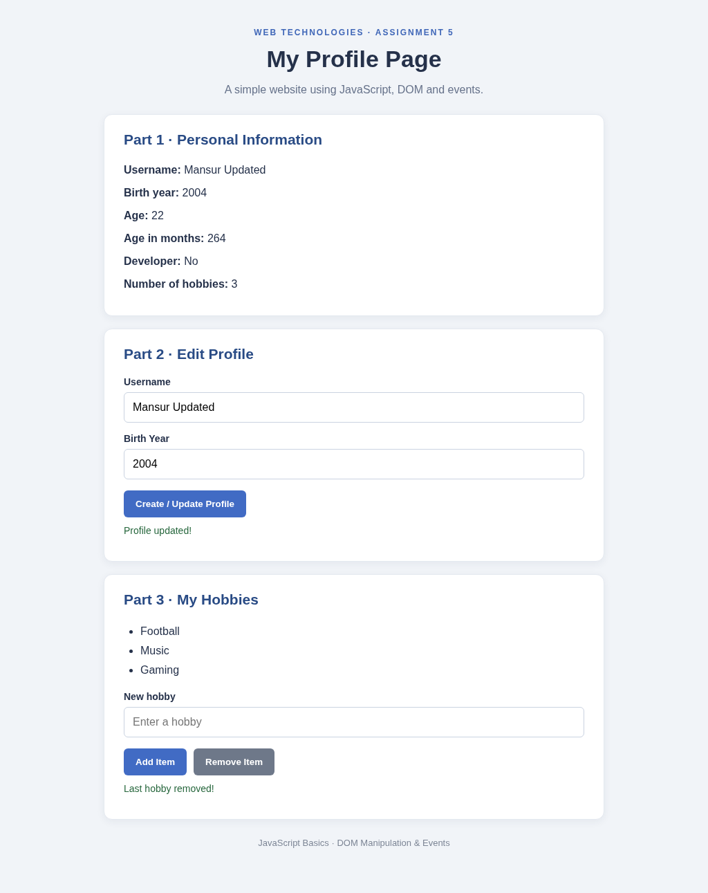

# Assignment 5 — JavaScript Basics

**Student:** Tleubay Abilmansur  
**Group:** SE2540  
**GitHub:** [pParalich](https://github.com/pParalich)

## Description

This is a simple personal profile page made with HTML, CSS, and JavaScript. The project uses JavaScript objects, arithmetic operations, event listeners, and basic DOM methods from the lessons.

## Part 1 — Profile Object, Data Types & Arithmetic (Tasks 1–2)

I created a `const userProfile` object with a string (`name`), number (`birthYear`), boolean (`isDeveloper`) and an array (`hobbies`). JavaScript uses the current year to calculate age, approximate age in months and the number of hobbies. The values are displayed on the page and in the browser console.

## Part 2 — Form Input & Event Responses (Tasks 3–4)

I added a form with username, birth year and a Create / Update Profile button. The `submit` event listener reads the input fields, updates the same `userProfile` object and refreshes the profile on the page. It also checks that the input is valid.

## Part 3 — DOM List Manipulation (Task 5)

I made an unordered list of hobbies. The Add Item button uses `createElement()` and `appendChild()` through the `showHobbies()` function to display the new hobby. The Remove Item button deletes the last hobby from the array and updates the list. The hobby counter also changes.

**After adding an item:**

**After removing the last item:**

## Work process

First I created the HTML structure and basic CSS. Then I wrote the profile object and calculations in JavaScript. After that, I added a form listener and the hobby list buttons. Finally, I tested the page by updating the profile and adding/removing list items. The changes were saved in separate Git commits.

## How to run

1. Download or clone this repository.
2. Open `index.html` in a web browser.
3. Try updating the profile and adding/removing hobbies.
4. Press F12 and open Console to see the JavaScript output.

No libraries or installation are required.

## GitHub Pages

After pushing to GitHub, enable **Settings → Pages → Deploy from a branch → main / (root)**. The expected Pages address for repository `assignment5-frontend` is:

`https://pparalich.github.io/assignment5-frontend/`

This address only works after creating the repository, pushing the code and publishing the page.
